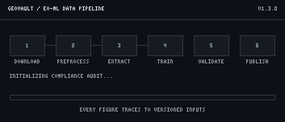

# 🌍 GeoVault

<p align="center"></p>

> **Remote Sensing, GIS & ML Data Stewardship Pipeline**

A stewardship toolkit for Earth-observation and geospatial machine learning: Sentinel-2, Landsat 9, UAV orthomosaic and DEM assets governed with FAIR + ISO 19115 metadata, DataCite-ready citation, cryptographic SHA-256 integrity and a provenance-tracked download-to-publish pipeline.

**Maintainer:** Syed Rafi Ahmed · RS/GIS/ML Lab · **Version:** 1.3.0 · **Released:** 2026-10-28 · **License:** MIT

**Domain:** Remote Sensing / GIS / Machine Learning · **Formats:** GeoTIFF, NetCDF, CSV · **Standards:** FAIR, ISO 19115, DataCite



*The animation above is itself governed: it is registered as `fig_03_pipeline`
in `figures/figure_manifest.yaml` and traces to every versioned dataset input
in the inventory.*

---

## ✨ Key Features

- 📋 **Centralized inventory** — every research asset is registered in a single YAML manifest
- 🔐 **Cryptographic integrity** — SHA-256 manifests are auto-generated when a dataset is scaffolded
- 📜 **Policy-driven licensing** — only licenses approved in `policies/rights_catalog.yaml` pass the audit
- 🏷️ **Strict semantic versioning** — every asset version must be `MAJOR.MINOR.PATCH`
- 🖼️ **Figure provenance** — every published figure traces to versioned, registered inputs via `figures/figure_manifest.yaml`
- 🎞️ **Animated pipeline demo** — `figures/fig_03_pipeline.gif` replays the 6-stage pipeline and is provenance-tracked like any published figure
- 🎨 **Deterministic brand logo** — `assets/logo.svg` (satellite over a raster grid with ML node links) is generated at scaffold time and embedded in this README and the dashboard
- 📐 **Spatial-metadata blueprint** — `blueprints/metadata_iso19115_template.yaml`, an ISO 19115-inspired profile for geospatial assets (CRS, extent, lineage)
- 🧪 **CI-green out of the box** — a pytest compliance suite plus a GitHub Actions compliance gate
- 🤖 **Machine-readable audits** — `--json` output for dashboards and CI pipelines
- 📊 **Interactive dashboard** — `dashboard.html` summarizes assets and live audit status
- 📓 **Auto-run validator notebook** — `notebooks/validator.ipynb` runs in Google Colab: live required-files checklist with expected headers, template downloads, upload previews, and a bundled demo dataset so *Runtime → Run all* finishes green with zero clicks

## 🚀 Quick Start

```bash
# 1. Create an environment
python -m venv .venv
source .venv/bin/activate          # Windows: .venv\Scripts\activate

# 2. Install dependencies
pip install -r requirements.txt

# Optional geo-ML stack (rasterio, geopandas, xarray, scikit-learn, torch/tf):
pip install -r requirements-ml.txt

# 3. Run the compliance audit
python -m geovault_core.inspector --strict

# 4. Run the test suite
python -m pytest tests/ -q

# 5. Optional: install the geovault package
pip install -e .
```

## 🔍 Inspector CLI

| Command | Purpose |
| ------- | ------- |
| `python -m geovault_core.inspector` | Human-readable compliance audit |
| `python -m geovault_core.inspector --json` | Machine-readable JSON report (CI / dashboard) |
| `python -m geovault_core.inspector --strict` | Treat warnings as errors (recommended for CI) |
| `python -m geovault_core.inspector --rehash` | Regenerate every `integrity.sha256` manifest |
| `python -m geovault_core.inspector --rehash inventory/<id>` | Regenerate one manifest (target must resolve inside `inventory/`) |

The inspector validates YAML syntax (reporting line numbers on parse errors),
checks that `record.yaml` identities match the registry and directory names,
enforces strict semver, verifies licensing against the rights catalog,
confirms each dataset directory holds at least one real data file, verifies
every SHA-256 entry with a path-traversal guard, and audits
`figures/figure_manifest.yaml` so every published figure traces to versioned,
registered inputs. `README.md`, `CHANGELOG.md`, `.DS_Store` and `Thumbs.db`
are never tracked by checksum manifests, so housekeeping edits cannot break
integrity.

## 📁 Repository Structure

```text
geovault/
├── geovault_core/            # Core validation engine
│   ├── __init__.py
│   └── inspector.py
├── src/geovault/        # Installable package (pip install -e .)
├── assets/                # brand logo (deterministic SVG)
├── inventory/             # registry.yaml + dataset folders
│   ├── registry.yaml
│   └── <asset_id>/        # record.yaml · data.csv · LICENSE.txt · integrity.sha256
├── policies/              # rights_catalog.yaml
├── blueprints/            # record/DMP/SOP templates + ISO 19115 spatial template
├── figures/               # figure_manifest.yaml + published figures (PNG + animated GIF)
├── tests/                 # pytest compliance suite
├── notebooks/             # validator.ipynb (Google Colab ready)
├── dashboard.html         # Interactive compliance dashboard
└── .github/               # Compliance gate CI + issue/PR templates
```

## 🧭 Pipeline Stages

GeoVault organizes stewardship into 6 provenance-checked
stages. The animated demo `figures/fig_03_pipeline.gif` replays them against
the registered inventory, and the inspector enforces the same rules at every
stage boundary.

| # | Stage | What happens |
| - | ----- | ------------ |
| 1 | **Download** | Scenes and tiles are pulled from approved providers (Copernicus, USGS, UAV base stations) and registered with provider IDs and acquisition dates. |
| 2 | **Preprocess** | Radiometric and atmospheric preprocessing, CRS harmonisation and cloud masking; every derived product keeps a link to its source scene version. |
| 3 | **Extract** | Spectral indices, features and training patches are extracted; scripts and parameters are pinned alongside the registry entry. |
| 4 | **Train** | Models (TensorFlow / PyTorch) are trained on versioned label sets; checkpoints and metrics land in the inventory with checksums. |
| 5 | **Validate** | The inspector audits metadata, licences, semver and SHA-256 integrity; figures must trace to versioned inputs. |
| 6 | **Publish** | Passing audits publish figures, the dashboard and DataCite-ready citation files (CITATION.cff). |

## ➕ Adding a New Dataset

1. Create `inventory/<asset_id>/` and add your data file(s) plus a `LICENSE.txt`.
2. Copy `blueprints/record_template.yaml` to `inventory/<asset_id>/record.yaml` and fill it in.
3. Register the asset in `inventory/registry.yaml`.
4. Auto-generate the integrity manifest:

   ```bash
   python -m geovault_core.inspector --rehash inventory/<asset_id>
   ```

5. If any published figure consumes this dataset, bump the dataset version in
   `inventory/registry.yaml` **and** update its pinned input version in
   `figures/figure_manifest.yaml`, then regenerate the figure.
6. Re-run the audit and tests — both must stay green:

   ```bash
   python -m geovault_core.inspector --strict && python -m pytest tests/ -q
   ```

## 🖼️ Figure Provenance

Published figures are mapped to the exact dataset versions they were built
from in `figures/figure_manifest.yaml`. The inspector fails the audit when a
figure references an unregistered asset, a stale input version, or a missing
output file — so bumping a dataset version in the registry forces every
dependent figure to be reviewed and regenerated before CI can go green again.

```yaml
figures:
  - figure_id: fig_01_overview
    outputs: [figures/fig_01_overview.png]
    inputs:
      - asset_id: sensor_data
        version: "1.0.0"
```

## 📓 Interactive Validator

Upload `notebooks/validator.ipynb` to [Google Colab](https://colab.research.google.com/)
via *File → Upload notebook*, then run *Runtime → Run all*. The notebook prints
an environment banner (toolkit, version, expected uploads), offers an optional
Google-Drive mount for large scene files, shows a live checklist of every file
it needs — including the exact CSV headers the validator expects — offers
one-click template downloads (one per registered dataset), previews each
upload automatically, and validates without any button click: with nothing
uploaded it audits a bundled demo dataset so the whole run finishes green.
After every audit it auto-saves `compliance_report.json`,
`compliance_report.txt`, `integrity.sha256` and `audit_summary.html` (on
Colab the JSON report downloads automatically) — commit the JSON next to
`dashboard.html` to refresh the dashboard's live-audit panel. Every check
mirrors the repository's inspector engine, so datasets that pass the notebook
pass CI too.

## 📜 License

MIT © 2026 Syed Rafi Ahmed (RS/GIS/ML Lab). See `LICENSE`.

## 📚 Citation

See `CITATION.cff`, or cite as:

> Syed Rafi Ahmed (2026). *GeoVault: Remote Sensing, GIS & ML Data Stewardship Pipeline*. Version 1.3.0. RS/GIS/ML Lab.
